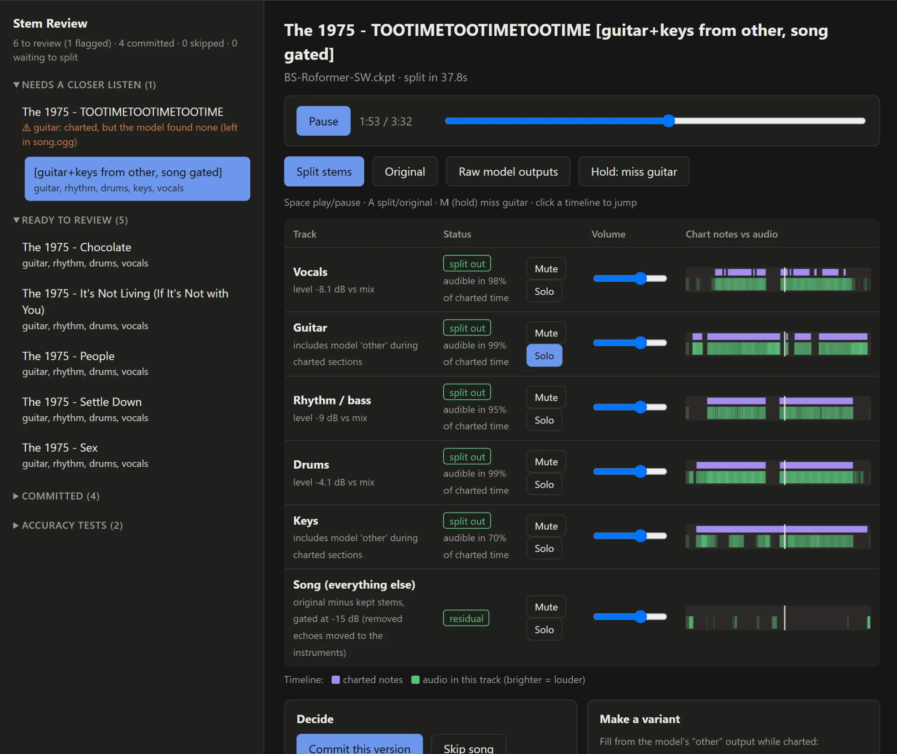

# yarg-stem-separator

Splits single-file YARG / Clone Hero songs (`song.ogg`) into instrument stems
(`vocals`, `guitar`, `rhythm` (bass), `drums`, `keys`) with the BS-Roformer-SW model,
lets you listen and choose, then writes the result into the song folder (undoable).



- Only instruments charted in `song.ini` / `notes.mid` get a stem; the new `song.ogg`
  is everything else, so all files played together reproduce the original.
- Nothing in your library changes until you press **Commit**.
- It only works on audio you already have; it doesn't download songs or audio of any kind.
- Needs Windows and an NVIDIA graphics card (the separation is done by an AI model).
- Only songs whose audio is `song.ogg` are processed. YARG also supports `.opus` and
  `.mp3` audio, but songs using those are skipped for now.

## Quick start

1. Install [uv](https://docs.astral.sh/uv/getting-started/installation/) (needed once, for setup).
2. Double-click **`Start Stem Separator.bat`**. The first run sets up Python and the
   separation packages (a few GB, several minutes); after that it starts in seconds.
   Your browser opens at http://localhost:8765/. Keep the black window open while you
   use it; close it to stop. Running the .bat again while it's open just reopens the page.
3. In **⚙ Library & splitting**, add your song folder (Browse… or paste a path), then
   **Start splitting**. Progress shows on the page; you can review finished songs while
   it runs, and stop/start any time. It carries on where it left off, and later runs only
   pick up new songs. The separation model (~300 MB) downloads on the first split.

## Reviewing

- **Needs a closer listen**: songs where a charted part is mostly missing from its stem
  (the model put it in "other"); the reason is shown. With *prepare a variant for flagged
  songs* on (default), a "fill from other + gated song" version is already built for these.
  **Ready to review**: everything else.
- Listen with mute/solo, **A** to switch to the original, hold **M** to "miss" guitar.
  Timelines show charted notes (purple) against what's audible in each stem (green).
- **Make a variant**: *fill from other* gives a charted instrument the model's unclassified
  audio while it's charted (for processed guitars and synth keys). *Gate song.ogg*
  mutes leftover echoes and moves them into the instruments (full mix unchanged); don't
  use it when song.ogg holds real uncharted music.
- **Commit this version** (the plain split or any variant) adds the stems to the song folder,
  renames the original to `song.ogg.orig`, and writes `stemsplit-commit.json` listing
  what was added. **Skip song** leaves the folder untouched. Both clear that song's
  staged files and move on to the next song.
- **Commit all unflagged songs** (under Library & splitting) commits the plain split of
  every song in "Ready to review" at once.
- Committed songs can be **undone** from the page: the added files are removed and
  `song.ogg` is restored. After committing, rescan songs in YARG.

Songs that already have stems are never touched. Staging takes about 60–90 MB per song
until it is committed or skipped (`staging/`).

## Manual setup and command line

The .bat does this on first run; to do it by hand (Windows, NVIDIA GPU):

```bash
uv venv --python 3.12 .venv
uv pip install --python .venv/Scripts/python.exe torch torchaudio --index-url https://download.pytorch.org/whl/cu128
uv pip install --python .venv/Scripts/python.exe "audio-separator[gpu]" soundfile imageio-ffmpeg mido audioread
cp .venv/Lib/site-packages/imageio_ffmpeg/binaries/ffmpeg-win-x86_64-v7.1.exe .venv/Scripts/ffmpeg.exe
```

The onnxruntime CUDA 13 warnings are harmless (RoFormer runs on PyTorch). Everything the
page does is also available from the command line:

```bash
.venv/Scripts/python.exe review.py --open                               # the web page
.venv/Scripts/python.exe stemsplit.py queue "D:/Games/YARG"             # split all new songs
.venv/Scripts/python.exe stemsplit.py split "<song folder>"             # one song, no queue
.venv/Scripts/python.exe stemsplit.py remix "staging/<song>" --fill guitar,piano --gate-song
.venv/Scripts/python.exe stemsplit.py undo "<song folder>"
.venv/Scripts/python.exe stemsplit.py bench "<folder that already has real stems>"
```

`bench` mixes a song's real stems, separates the mix, and scores each stem (SDR)
so models can be compared on your own music; results show under "Accuracy tests".
