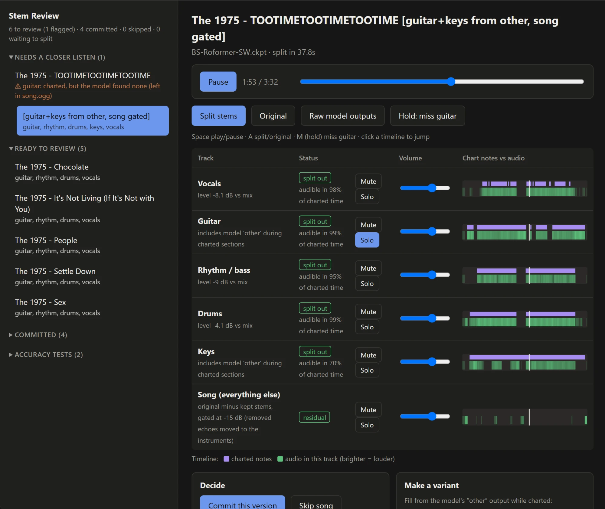

# yarg-stem-separator

[](https://github.com/sidasta/yarg-stem-separator/actions/workflows/linux-smoke-test.yml)

Splits single-file YARG / Clone Hero songs (`song.ogg`, `.opus`, `.mp3` or `.wav`) into instrument stems
(`vocals`, `guitar`, `rhythm` (bass), `drums`, `keys`) with the BS-Roformer-SW model,
lets you listen and choose, then writes the result into the song folder (undoable).

**New in v0.3.0: vocal charting from lyrics.** Songs whose chart has no vocals can get a
vocal chart: paste the lyrics, and they're lined up with the separated vocal track and
turned into notes at the sung pitch. It's a quick starting point, **not as accurate as
charting by hand**, so check it and fine-tune in a chart editor if needed.
See [Songs with no vocals charted](#songs-with-no-vocals-charted). This also works for
`notes.chart` songs (converted to `notes.mid`), including ones already committed.



- Only instruments with notes in the chart (`notes.mid` or `notes.chart`) get a stem,
  unless `song.ini` marks them as not charted (difficulty -1); the new `song.ogg` is
  everything else, so all files played together reproduce the original.
- Nothing in your library changes until you press **Commit**.
- It only works on audio you already have; it doesn't download songs or audio of any kind.
- Runs on Windows and Linux. The separation is done by an AI model, which is fastest on a
  graphics card (see [Hardware](#hardware)); any PC can use the slower CPU-only mode.
- Works with song folders whose audio is `song.ogg`, `song.opus`, `song.mp3` or `song.wav`.
  New tracks are always written as `.ogg`. Most testing has been on `.ogg` songs.
- Rock Band CON packages are supported when they hold a single song whose audio is
  **unencrypted** and is one full mix in the backing track (common for customs that
  aren't multitrack). Encrypted CON audio is never decrypted; those, multi-song packs and
  CONs that already have separate tracks are skipped and listed on the page with the
  reason, so you can see which ones need handling elsewhere.

## CON packages

The scan recognises CON files by their header (any file name). A usable one is staged
like any other song: the backing audio, chart (`notes.mid`), a `song.ini` built from its
`songs.dta` and the album art are extracted into `staging/_con/`. Nothing changes in the
library until you commit. Then:

- a folder `Artist - Title` is created next to the CON with the stems, chart, `song.ini`
  and `album.png`;
- the CON file is moved to `con-backups/` (next to `staging/`, outside your library) so
  YARG doesn't list the song twice;
- **Undo** moves the CON back and removes the files the conversion created.

Difficulties in `song.ini` are mapped from the CON's Rock Band difficulty ratings.

## Quick start

1. **Download:** [click here to download the latest version as a ZIP](https://github.com/sidasta/yarg-stem-separator/archive/refs/heads/main.zip)
   (or, on this page, click the green **Code** button, then **Download ZIP**).
   Right-click the ZIP, choose **Extract All…**, and put the folder somewhere
   *outside* your YARG songs folder (e.g. `Documents`). Don't run it from inside the ZIP.
2. Double-click **`Start Stem Separator.bat`** in the extracted folder. If Windows shows a
   security warning (it does for any downloaded script), choose **Run**, or on a
   "Windows protected your PC" screen click **More info**, then **Run anyway**.
   The first run sets up everything it needs (a few GB, several minutes); after that it
   starts in seconds. Your browser opens at http://localhost:8765/. Keep the black window
   open while you use it; close it to stop. Running the .bat again while it's open just
   reopens the page.
3. In **⚙ Library & splitting**, add your song folder (Browse… or paste a path), then
   **Start splitting**. Progress shows on the page; you can review finished songs while
   it runs, and stop/start any time. It carries on where it left off, and later runs only
   pick up new songs. The separation model (~300 MB) downloads on the first split.

**What the first run installs, and where:** the .bat uses [uv](https://docs.astral.sh/uv/)
to set up Python and the packages. If uv isn't installed, it downloads a private copy
from uv's official GitHub release (checksum-verified) into the `tools` folder, and keeps
Python and its download cache there too, so nothing is installed system-wide and
**uninstalling is just deleting the folder**. (If you already have uv, it's used as normal.)
If you move the folder later, the .bat notices and quickly rebuilds its setup.

## Hardware

The launcher detects your hardware and installs the matching version automatically:

| Hardware | Speed (4-minute song) | Status |
|---|---|---|
| **NVIDIA** graphics card | ~45 seconds | Tested (Windows); Linux untested |
| **AMD Radeon** on Linux (recent RX 7000 / RX 9000) | GPU speed | Untested — uses PyTorch's official ROCm build |
| **AMD Radeon** on Windows (recent RX 7000 / RX 9000) | GPU speed | **Experimental, untested** — uses AMD's PyTorch for Windows; needs AMD driver 26.2.2 or newer; no vocal charting |
| No supported graphics card (CPU only) | ~10–15 minutes | Tested (Windows); Linux checked automatically on every launcher change |

If an AMD card is found but can't be used (older card or driver), the CPU version is
installed instead, because AMD's build is very slow without a working GPU. The
**Library & splitting** page shows what it's running on. If you try the AMD or Linux
routes, please report how it goes in the GitHub issues.

The Linux launcher is checked by a [GitHub Actions smoke test](.github/workflows/linux-smoke-test.yml)
on a clean Ubuntu machine: it sets itself up from scratch (CPU mode), starts the page and
splits a short generated clip. It runs whenever the launcher or setup script changes, and
can be run by hand from the repository's **Actions** tab.

To force a choice, set `STEMSEP_DEVICE` to `nvidia`, `amd` or `cpu` before the first run
(e.g. `set STEMSEP_DEVICE=cpu` in a Command Prompt, then run the .bat from it). To switch
later, delete the `.venv` folder and run the launcher again.

### Linux

Download and extract as above (outside your songs folder), then from a terminal:

```bash
./start-stem-separator.sh          # or: bash start-stem-separator.sh
```

It does the same as the .bat (needs `curl`, `tar` and `sha256sum`, which most distros
have). For AMD cards, the ROCm driver must already be installed (AMD supports Ubuntu
22.04/24.04).

## Reviewing

- **Needs a closer listen**: songs where a charted part is mostly missing from its stem
  (the model put it in "other"); the reason is shown. With *prepare a variant for flagged
  songs* on (default), a "fill from other + gated song" version is already built for these.
  **Ready to review**: everything else.
- Listen with mute/solo, **A** to switch to the original, hold **M** to "miss" guitar.
  Timelines show charted notes (purple) against what's audible in each stem (green).
- **Make a variant**: *fill from other* gives a charted instrument the model's unclassified
  audio while it's charted (for processed guitars and synth keys). *Gate song.ogg*
  mutes leftover echoes and moves them into the instruments (full mix unchanged); don't
  use it when song.ogg holds real uncharted music.
- **Commit this version** (the plain split or any variant) adds the stems to the song folder,
  renames the original audio to `song.<ext>.orig` (e.g. `song.mp3.orig`), and writes `stemsplit-commit.json` listing
  what was added. **Skip song** leaves the folder untouched. Both clear that song's
  staged files and move on to the next song.
- **Commit all unflagged songs** (under Library & splitting) commits the plain split of
  every song in "Ready to review" at once, except songs with no vocals charted (see below).
- Committed songs can be **undone** from the page: the added files are removed and
  the original song audio (and chart, if vocals were added) is restored. After committing,
  rescan songs in YARG.

### Songs with no vocals charted

> **Accuracy:** this is automatic charting, so expect mistakes: notes can land slightly
> early or late, fast or held syllables may be split oddly, and pitch can be off where the
> singing is breathy, heavily effected or doubled. It gets you a playable chart quickly,
> but it isn't as accurate as charting by hand.

If a song's chart has no vocal part, its review page asks whether it's an instrumental.
If it isn't, paste the lyrics and press **Chart vocals**:

- The lyrics are lined up with the separated vocal track, each syllable gets a note at the
  pitch that's sung, and the notes are snapped to the chart's own tempo map as a new
  `PART VOCALS` track (one phrase per lyric line). The split is then rebuilt with
  `vocals.ogg` split out, so you can check the charted notes against the singing on the
  vocals timeline. Nothing is separated again; it takes about half a minute on a GPU.
- Paste one sung line per line. Labels like `[Chorus]` are ignored; words in
  (parentheses) are treated as backing vocals and left out; write repeats out in full.
- The page lists lines worth checking and stretches of singing with no lyrics (backing
  vocals, "oohs"). It's a solid starting point rather than a hand-made chart: for
  fine-tuning, commit and open it in a chart editor.
- Commit also replaces `notes.mid` and `song.ini` (vocal difficulty set), keeping the
  originals as `notes.mid.orig` and `song.ini.orig`; undo puts them back.
- **`notes.chart` songs:** a `.chart` can't hold sung vocals, so the chart is converted
  to `notes.mid` with the vocals added, and `notes.chart` is kept as `notes.chart.orig`
  (with both in the folder, the game would read only one). If the `.chart` has its own
  lyric events, the lyrics box starts with them; check them against the song. See
  [notes.chart songs](#noteschart-songs) for what the conversion keeps.
- The first time, the lyric alignment model (about 1.2 GB) is downloaded into `models/`.
  It isn't available with AMD's experimental Windows PyTorch, which has no torchaudio.
  Songs whose chart is shifted against the audio by 100 ms or more (`delay` in
  `song.ini`, or the `.chart`'s `Offset`) aren't supported yet.

**Songs committed before their chart could be read** (e.g. `notes.chart` songs split with
an earlier version) may have a `vocals.ogg` but no vocal part. They're listed under
**Committed, no vocals charted**: paste the lyrics, and the vocals are charted from that
`vocals.ogg` and staged for you to listen to. Committing writes only the chart files
(the originals kept as `.orig`, as above). **Remove the charted vocals** takes them back
out, and undoing the song's whole commit removes them too. Each library scan checks
committed songs for this.

### notes.chart songs

Songs charted in `notes.chart` (Moonscraper / Clone Hero format) are read directly: their
notes decide which instruments get a stem and fill the timelines. When vocals are added,
the chart is converted to `notes.mid`. Every note keeps its timing and type (strum, HOPO,
tap, open; cymbal or tom, accent, ghost, 2x kick), along with sustains, star power, solos,
drum fills and sections. This was checked against the original `.chart` files with
[scan-chart](https://github.com/Geomitron/scan-chart) on 20 songs, all identical to
within 0.2 ms. Where `notes.mid` can't say something, `song.ini` gains a setting (for
example `sustain_cutoff_threshold`, so short sustains survive, and song details that were
only in the `.chart`). Two things `notes.mid` can't store: star power and drum fills that
differ per difficulty (every difficulty gets Expert's), and the `.chart`'s lyric events
(replaced by the charted vocals).

To convert a chart by hand:

```bash
.venv/Scripts/python.exe chartfile.py "<song folder>/notes.chart" "<song folder>/notes.mid"
```

It prints any `song.ini` settings to add. Then move `notes.chart` out of the folder.

Songs that already have stems are never touched. Staging takes about 60–90 MB per song
until it is committed or skipped (`staging/`).

## Manual setup and command line

The launchers do this on first run; to do it by hand:

```bash
uv venv --python 3.12 .venv
.venv/Scripts/python.exe scripts/setup_env.py      # Linux: .venv/bin/python
```

`scripts/setup_env.py` picks the hardware (or uses `STEMSEP_DEVICE`), installs the
matching PyTorch build and the separation packages, and copies ffmpeg into the venv.

The onnxruntime CUDA 13 warnings are harmless (RoFormer runs on PyTorch). Everything the
page does is also available from the command line (on Linux use `.venv/bin/python`):

```bash
.venv/Scripts/python.exe review.py --open                               # the web page
.venv/Scripts/python.exe stemsplit.py queue "D:/Games/YARG"             # split all new songs
.venv/Scripts/python.exe stemsplit.py split "<song folder>"             # one song, no queue
.venv/Scripts/python.exe stemsplit.py remix "staging/<song>" --fill guitar,piano --gate-song
.venv/Scripts/python.exe stemsplit.py undo "<song folder>"
.venv/Scripts/python.exe stemsplit.py bench "<folder that already has real stems>"
```

`bench` mixes a song's real stems, separates the mix, and scores each stem (SDR)
so models can be compared on your own music; results show under "Accuracy tests".
